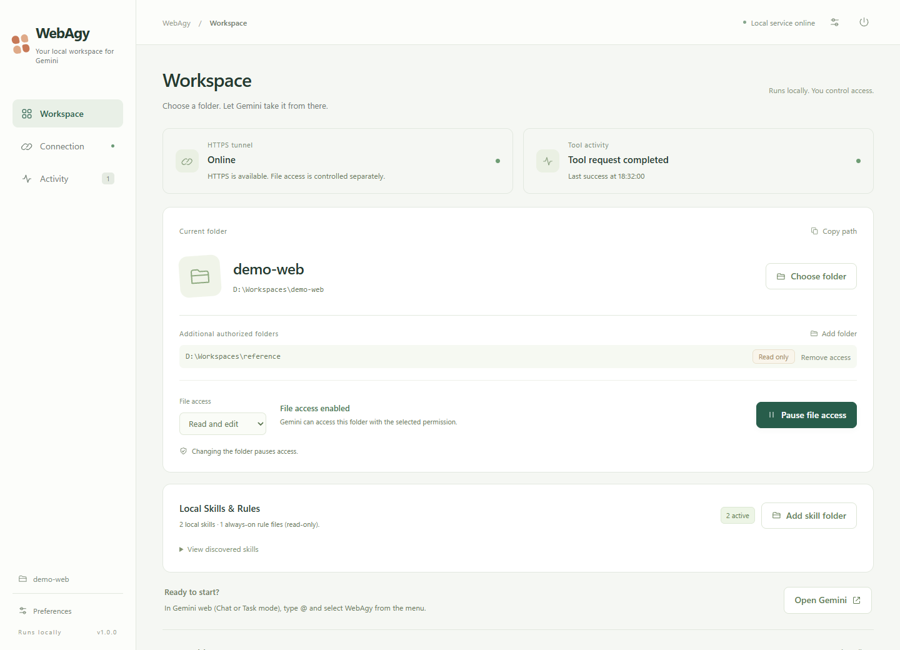

# WebAgy

[简体中文](README.zh-CN.md) · [Download WebAgy for Windows](https://github.com/nexora-dev9/WebAgy/releases) · [MIT License](LICENSE)

WebAgy connects **Gemini on the web** to Windows folders you authorize. In **Chat** or **Task**, select **@WebAgy** to read, create, edit, or organize local files. Gemini can also read local `SKILL.md` instructions and their resources. The connection uses Gemini's native custom apps and MCP, with your eligible Gemini web account and no separate model API key.

## Get started

1. Download the Windows x64 ZIP from [GitHub Releases](https://github.com/nexora-dev9/WebAgy/releases), fully extract it, and open `Start-WebAgy.cmd`. The package includes Node.js and the app's runtime dependencies. A source build requires Node.js 22.13 or newer, Windows PowerShell 5.1, and the .NET Framework C# compiler. See the [installation guide](docs/SETUP.md).
2. In **Workspace**, select a folder and choose **Read only** or **Read and edit**. Enable file access when you're ready.
3. In **Connection**, configure ngrok with your own domain and token, or choose Cloudflare Tunnel. Quick creates a temporary address, while Named uses your own hostname and tunnel token. Copy the private MCP URL once the tunnel is online. See [tunnel choices](docs/NETWORKING.md).
4. Add the private URL under [Gemini → Connected Apps](https://gemini.google.com/customize/connectors?hl=en). The app should discover **12 tools**, including `read_skill`. Google's [custom app eligibility and setup guide](https://support.google.com/gemini/answer/17209137?hl=en-12) describes the account, location, history, and English-interface requirements.
5. Open a new **Chat** or **Task**, type `@`, and select the app from the menu. For a first test, ask Gemini to create a uniquely named text file in a test folder and read it back. Approve the write if prompted. Verify the file and the successful entry in **Activity**.

WebAgy opens in **English** on a fresh install. Choose **Preferences → Language → 简体中文** to switch. The app saves the choice locally and restores it on the next launch, including the tray and WebAgy's folder picker text. The Gemini website has its own language settings.

The control panel at `http://127.0.0.1:3008/` points to your own computer. Gemini uses the private HTTPS MCP address shown in **Connection**. Treat that full address as a password.

## What v1.0 includes

| Capability | Details |
| --- | --- |
| Local files | Read and search large text, documents, spreadsheets, and images. Create or edit UTF-8 text and organize files. |
| Multiple folders | Use relative paths from the primary folder or absolute paths within any authorized folder. Lock individual folders and their descendants to read only. |
| Local Skills | Select skill folders in the dashboard. Gemini discovers skill summaries through `workspace_info` and retrieves instructions or resources through `read_skill`. The tool reads scripts as text. Commands require a separate grant. |
| Snapshots and Activity | Review tool results, selectively restore eligible files from before an edit, and see command exit codes. Read-only locks also apply to restores. |
| Optional builds and tests | Allow PowerShell commands independently. The starting directory is checked and commands run with your Windows account's permissions. |
| Tunnel choices | ngrok and Cloudflare Tunnel through `cloudflared`. Use your own credentials and choose automatic startup in Preferences. |

The workflow is designed for **Gemini web local file access**, including browser-based coding, document analysis, and skill-guided edits on Windows. See [tool parameters](docs/AGENT_TOOLS.md), [supported file formats](docs/READING.md), and [security and data handling](SECURITY.md).

Manually added Gemini custom apps ask for confirmation on writes. If you use a registered Connected App, Google's Connected Console lets you configure confirmation per tool. Keep the confirmation that suits the tool's authority, especially for commands and deletion. See the [registered app guide](docs/CONNECTED_APPS_PLATFORM.md).

## Guides

- [Troubleshooting](docs/TROUBLESHOOTING.md) for a paused workspace, missing tools, tunnel errors, or an app that connects without working on files.
- [Usage and model limits](docs/USAGE.md) for fewer round trips and effective file tasks.
- [AI-assisted setup](docs/AI_SETUP.md) for an agent-readable installation brief.
- [Changelog](CHANGELOG.md) and [contributing](CONTRIBUTING.md) for release changes and local tests.

This is the open-source successor to ArgonDesk. WebAgy is an independent Windows project under the MIT license. Share clean source or release packages. Keep used installations, account credentials, private tunnel URLs, local history, snapshots, and personal work files on your machine.
